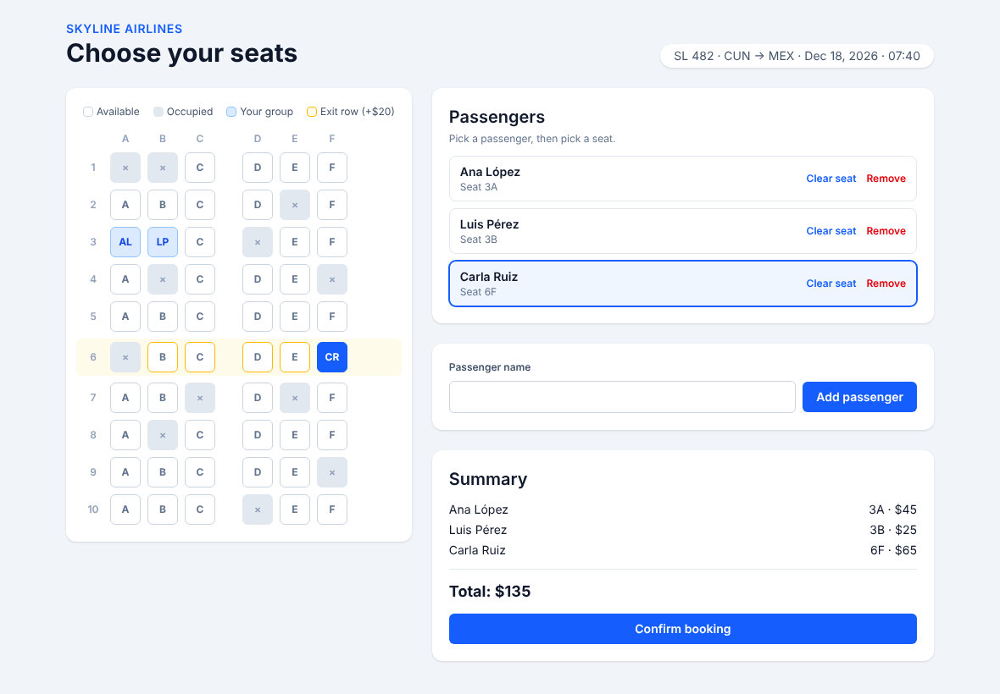

# SkyLine Seat Picker

## Challenge Description

SkyLine Airlines ✈️ is launching a new seat picker for group bookings, and the first version is already in testing. Users can choose a passenger, pick a seat on the map and see a booking summary. But QA found **three bugs**, and the product team needs **passenger management and a booking confirmation** before launch.

This challenge has two parts:

1. **Fix three bugs** in the existing app.
2. **Build a new feature**: add and remove passengers, keep the seat rules consistent, and confirm the booking.

It focuses on three topics: **`useState`**, **props & components**, and **event handling**.

### How the app works

- `components/SeatMap.jsx` renders a plane with 10 rows of 6 seats (A–F). Each seat is rendered by `components/Seat.jsx`.
- Seat prices: **window $45**, **aisle $35**, **middle $25**. Row 6 is an **exit row** and costs **$20 extra**. Some seats are already occupied by other travelers.
- `components/PassengerList.jsx` shows a card for each passenger. Click a card to make that passenger **active**, then click a seat to assign it to them.
- `components/BookingSummary.jsx` lists each passenger's seat and price, and shows the total.
- The seat helpers (`calculateTotal`, `getSeatPrice`, etc.) are in `utils/seats.js`, and the flight data is in `data/flight.js`.

## Requirements

### Part 1 – Fix the bugs

QA reported the following bugs. Find the cause of each one and fix it:

- 🐞 **Occupied seats can be selected.** Seats taken by other travelers look available and can be assigned to a passenger. They must be shown as occupied and must not be selectable.
- 🐞 **The total never changes.** The summary always shows `Total: $0`, even after assigning seats. The total must always match the seats currently assigned.
- 🐞 **"Clear seat" changes the active passenger.** Clicking "Clear seat" on a passenger's card clears the seat, but it also makes that passenger active. It must only clear the seat; the active passenger must not change.

> 💡 HINT: Each bug is related to one of the three topics of the challenge: props, state and events.

### Part 2 – Feature: passengers & booking confirmation

**Seats**

- A seat assigned to one passenger cannot be assigned to another passenger.
- When a passenger picks a new seat, their previous seat becomes available again.
- When a seat is cleared, it becomes available again and the total is updated.

**Add passengers**

- Add a form with a text input labeled **"Passenger name"** and a submit button with the text **"Add passenger"**.
- When submitted with a valid name, a new passenger is added to the list with no seat, and the input is cleared.
- If the name is empty (or only spaces), show the error message **"Name is required"** and don't add the passenger.
- A booking can have a **maximum of 4 passengers**. When the limit is reached, no more passengers can be added.

**Remove passengers**

- Each passenger card has a button with the text **"Remove"**.
- Removing a passenger also frees their seat and updates the total.
- If the removed passenger was the active one, the **first passenger** in the list becomes active.
- The booking must always have at least one passenger, so the last passenger cannot be removed.

**Confirm the booking**

- Add a **"Confirm booking"** button to the summary. It's only enabled when **every** passenger has a seat.
- Clicking it replaces the seat map with a confirmation screen that has a heading with the text **"Booking confirmed"**, each passenger's name and seat, and the total price.
- The confirmation screen has an **"Edit booking"** button that returns to the seat map. All passengers and seats must be kept.

> 💡 HINT: Before creating a new state variable, check whether the value can be calculated from the state you already have.
>
> 💡 HINT: Think about which component should own each piece of state, and pass data and event handlers down with props.

## Other Considerations

- If you see a `data-testid`, `aria-label` or `aria-current` attribute in the boilerplate, don't remove or rename it. If you remove it, your code may be invalid for the certificate.
- Keep the seat text on each passenger card as `Seat 3A` or `No seat`, and keep the total with the format `Total: $X`.
- Use the exact texts described above for buttons, labels, headings and messages (upper or lower case doesn't matter).
- Don't modify the files in the `tests/` or `.github/` folders.
- Your code will be linted and must be clean of anti-patterns. Follow best practices; for example, never mutate state directly and avoid redundant state.
- You decide how to structure the state and which new components to create. The tests check the behavior, not the implementation.
- TailwindCSS is preinstalled with the default config, and `index.css` already includes classes for the new form and the confirmation screen. It might be helpful for you, if you want to have some styles. (Not obligatory)
- 👀 Don't peek at the solution until you've solved the exercise yourself or exhausted your resources. Challenging yourself will best prepare you for the exam.

## Running the Project

```bash
npm install
npm run dev    # start the app
npm test       # run the tests in watch mode
npm run lint   # check for lint errors
```

Every push to the repository is graded automatically with the same tests.

## Example of Finished App

This is an example of what the functionality should look like for the completed exercise. If you'd like to mimic this style, feel free to do so, but it is not required.


